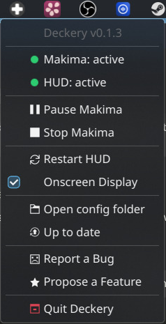

# deckery-tray

**Repository:** [Plasma-Deckery/deckery](https://github.com/Plasma-Deckery/deckery) (bundled in the main repo, under `tray/`)

System tray applet that monitors and controls the full Deckery stack from a single icon in the KDE panel.



## What it does

- **Service status** — live display of the running state of makima and the HUD in the tray menu
- **Pause / Resume** — sends `pause` / `resume` over the makima IPC socket without restarting the service
- **Restart / Start / Stop** — controls makima and deckery-hud via systemd user units
- **Controller Bindings** — submenu listing all known configs with live status, modules indented under the base config they apply to; modules and app overrides toggle with a checkbox, mutually exclusive modules are a submenu of radio items instead; a row with a problem carries `⚠️` or `🛑` and opens a scrollable dialog on click
- **Updates** — "Search for Updates" entry; on an RPM install it points to the system update (and offers to start `rpm-ostree upgrade` where possible), on an install.sh checkout it pulls all repos and re-runs the installer
- **Config folders** — "Open my configs" and "Open shipped configs" open either directory in the file manager
- **Steam Input** — shows whether Steam's Desktop Input is disabled (green) or still active (yellow); clicking the yellow indicator opens a terminal that writes the configset entry and optionally restarts Steam
- **Tooltip** — always shows "Deckery" on hover for quick identification

## Tray icon states

| Icon | Condition |
|---|---|
| 🟢 Green | All services active, no errors |
| 🟡 Amber | Any service not fully active; makima paused; makima reinitialising after device reconnect/resume (`lifecycle: "starting"` or `"reinitialising"`); Steam Input still active |
| 🔴 Red | Any service failed; no device found (`errors.no_device`); base config parse error (`errors.base_config`) |
| 🎮 Gaming | Gaming Mode active (overrides amber) |

## Architecture

Built with GTK3 + AyatanaAppIndicator3. On an RPM install (the `deckery-tray` package) it runs directly on the host: `packaging/deckery-tray.service` starts `/usr/bin/python3 /usr/lib/deckery/tray/deckery-tray.py` with `PYTHONPATH=/usr/lib/deckery/tray`. No container is involved.

**Service hierarchy:**

```
graphical-session.target  ← desktop session; the tray skips itself while gamescope-session* is active
    └── deckery-tray.service  ← starts on login
            ├── makima.service       (BindsTo tray — cannot run without it)
            └── deckery-hud.service  (BindsTo tray — cannot run without it)
```

`deckery-tray.service` is `After=` and `BindsTo=graphical-session.target`. The package enables it vendor-side, through a link in `/usr/lib/systemd/user/graphical-session.target.wants/`, so no `systemctl --user enable` is needed; makima and deckery-hud are pulled in the same way, through links in `/usr/lib/systemd/user/deckery-tray.service.wants/` (their units are `WantedBy=deckery-tray.service`). An `ExecCondition` guard skips the start while any `gamescope-session*` user unit is active, so in Gaming Mode Deckery does not start and does not interfere with Gamescope; a failed condition skips the service cleanly without a restart loop.

Up to deckery-tray 0.4.0 the tray was `WantedBy=plasma-core.target` and enabled by hand. A `plasma-core.target.wants/deckery-tray.service` link left in `~/.config/systemd/user/` from that time would form an ordering cycle with `graphical-session.target`, so `deckery-tray-migrate.service` removes it on login.

**Legacy / dev path (install.sh):** the old `install.sh` install links `systemd/deckery-tray.service` into `~/.config/systemd/user/` and enables it with `systemctl --user enable`. That unit has the same `[Unit]` section and `ExecCondition`, but runs the tray inside the `deckery` distrobox container: `ExecStartPre=/usr/bin/podman start deckery`, then `ExecStart=%h/.local/bin/deckery-tray`, a symlink to the `deckery-tray-launch` wrapper, which runs `distrobox enter deckery -- python3 <repo>/tray/deckery-tray.py`. Starting the container from the tray unit puts its main `conmon` process in the tray's cgroup, so stopping the tray also stops the container.

**State tracking:**

| Source | Used for |
|---|---|
| `systemctl --user is-active` | Running state of makima and deckery-hud |
| `$XDG_RUNTIME_DIR/makima-state.json` | `paused`, `lifecycle`, `errors`, `configs` |
| `$XDG_RUNTIME_DIR/makima-control.sock` | Sending IPC commands (pause / resume, `config enable\|disable`, `config group enable\|disable`) |
| `configset_controller_neptune.vdf` | Steam Input configured state (polled every 2 s) |

Status updates run on a background thread to keep the GTK main loop responsive. A `Gio.FileMonitor` on `makima-state.json` triggers an immediate debounced refresh (120 ms window) whenever the file changes — pause state changes appear in the menu within milliseconds.

**Makima service menu item** displays a per-state label based on `state.json`:

| Condition | Dot colour | Label shown |
|---|---|---|
| Gaming Mode | gaming | `Gaming Mode` |
| paused | amber | `paused` |
| `lifecycle` is `"starting"` or `"reinitializing"` | amber | `reinitializing…` |
| `errors.no_device` present | red | `no device` |
| `errors.base_config` present | red | `config error` |
| ready, no errors | green | `active` |

The row is checked in that order, so Gaming Mode and a pause outrank a startup
in progress.

Both red states append `— click for details`, and the row opens the message
makima wrote behind them: which `[device] names` list to check, or which file
failed to parse. The two words alone cannot carry that, and the row is
clickable in every state — greying it out would read as "unavailable", and a
click with nothing to report does nothing.

When `errors.no_device` is set, **Pause Deckery** is hidden from the menu — pausing an input mapper that has no device is meaningless.

**Controller Bindings submenu (`config_menu.py`):**

The submenu is managed by a dedicated `ConfigSubmenu` class in `tray/config_menu.py`. It holds one permanent slot per config name (a `CheckMenuItem`/`MenuItem` pair). Slots are created at startup from the initial `state.json` read; if a new config appears at runtime a slot is appended live. Slots are never destroyed — they are hidden when their config is absent.

Members of an `exclusive_group` get a `RadioMenuItem` instead, inside a submenu
of their own whose parent item names the active member ("KDE Desktop Layout:
Vertical"). A submenu is what says "one choice" whatever the panel does with
radio items, and folding the members away costs nothing, because the heading
already says which one is on.

Two GTK details shape that code:

- An item carrying a submenu draws **no checkbox** through dbusmenu, and a click
  opens the submenu rather than toggling. The group's own on/off switch
  therefore sits *inside* it, as the first entry.
- A radio item cannot be cleared: `set_active(False)` on the one that is on does
  nothing, because GTK will not leave a radio group with nothing selected. A
  switched-off group would keep showing a ticked member. Each group therefore
  owns an extra radio item that is never appended to any menu — selecting it is
  invisible and clears every member.

Live updates work via dbusmenu property propagation: label, active state, and visibility changes always reach the panel. Structural additions use `append()` (not `insert()`) because dbusmenu only propagates `append()` to already-cached submenus.

## Related

- [makima-deckery](makima-deckery/index.md) — produces the state JSON and IPC socket
- [deckery-hud](deckery-hud.md) — managed by the tray as a dependent service
